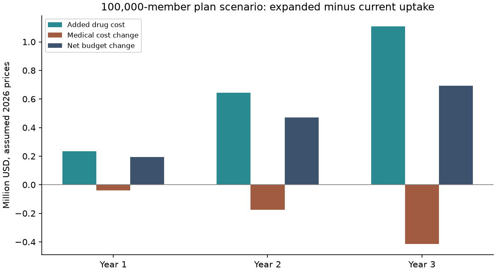

# Dapagliflozin in CKD Economic Modelling

**Cost effectiveness, budget impact and synthetic claims methods | Python and SQL**

A reproducible health economic modelling project examining dapagliflozin added to standard care for a hypothetical population with type 2 diabetes and chronic kidney disease. It combines a monthly cohort model, an open-population budget model and uncertainty analysis using published kidney-function transitions, US public spending references and Medicare drug-price scenarios.

A separate synthetic longitudinal-data module evaluates causal estimation under measured confounding, informative censoring, unmeasured confounding and lack of treatment overlap. Its treatment effects are generated for method evaluation and do not enter the economic model.

[Read the results](results/REPORT.md) · [Methods](METHODS.md) · [Sources and assumptions](SOURCES.md)

## Decision questions

- How do incremental costs and quality-adjusted survival change when dapagliflozin is added to standard care?
- How does expanded use affect drug spending, medical spending and the budget of a hypothetical health plan?
- Which assumptions drive the economic findings, and when do weighting methods recover a known simulated effect?

## Implementation

| Module | Implementation |
| --- | --- |
| Cost effectiveness | Monthly CKD stages, dialysis, transplant and death; discounted costs, QALYs, ICERs, net monetary benefit and a conditional drug-price threshold |
| Budget impact | Existing users, new eligible members, uptake targets, discontinuation and plan exits; annual incremental costs and per-member-per-month spending |
| Uncertainty | Deterministic alternatives and probability-based scenarios over explicitly specified parameter distributions |
| Synthetic claims | Enrollment, diagnoses, linked laboratory results, prescriptions and outcomes; SQL new-user cohort construction |
| Causal methods | IPTW and IPCW, competing death, bootstrap intervals and repeated known-truth simulation |
| Quality control | Source fingerprints, transition checks, cohort accounting, independent cashflow reconciliation and automated tests |



## Scope

The economic outputs are exploratory scenarios. Published renal transitions come from a mixed diabetes-status population; mortality, parts of costing, initial population composition and transfer to the target setting remain assumptions. The model has not been clinically calibrated or externally validated for a US diabetes population. Price inputs are Medicare negotiated-price references, not observed net payer costs.

The synthetic comparison uses dapagliflozin versus sitagliptin, while the economic model compares dapagliflozin plus standard care with standard care. These comparisons are distinct. Artificial records and simplified clinical labels are not real claims evidence or validated clinical phenotypes.

## Repository

| Location | Contents |
| --- | --- |
| [Results](results/REPORT.md) | Economic results, figures and simulation findings |
| [Methods](METHODS.md) | Equations, implementation choices and interpretation |
| [Sources](SOURCES.md) and [parameters](parameters/) | Public evidence, transformations and scenario assumptions |
| [Model](model/) and [SQL](sql/cohort.sql) | Economic calculations, simulation and cohort construction |
| [Tests](tests/) and [validation](results/validation.json) | Computational checks and reproducibility records |

## Reproduce

The reference runtime is Python 3.12; direct dependency versions are recorded in `requirements-lock.txt`. Run these commands one line at a time in Terminal:

```sh
git clone https://github.com/CJisAgirl/dapagliflozin-ckd-model.git
cd dapagliflozin-ckd-model
python3 -m venv .venv
source .venv/bin/activate
python -m pip install -r requirements-lock.txt
python run.py
```

The runner executes tests, economic scenarios, uncertainty analysis, synthetic-data estimation and repeated simulations, then generates figures and the English report. The full run can take several minutes. Successful completion prints the path to `results/REPORT.md`.

The default model uses the saved public-source parameters offline. `python run.py --verify-sources` also downloads and checks the pinned CMS and publication source files. `python run.py --quick` writes a smaller diagnostic run under `results/quick/` without overwriting the reference results. Synthetic individual records are generated locally under `data/` and excluded from version control. No R installation, API key or licensed patient database is required.

## Methods demonstrated

Health economic modelling, evidence synthesis, parameter provenance, scenario analysis, SQL cohort construction, longitudinal data handling, causal inference diagnostics and reproducible computational validation.
