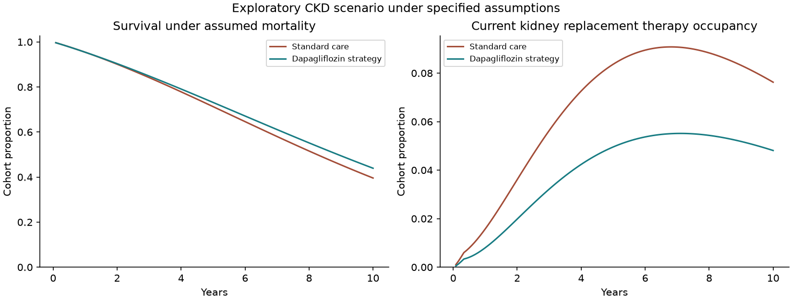
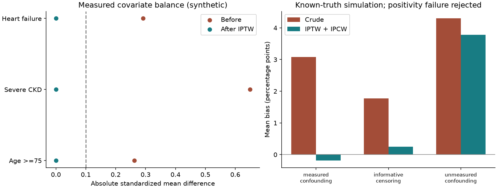
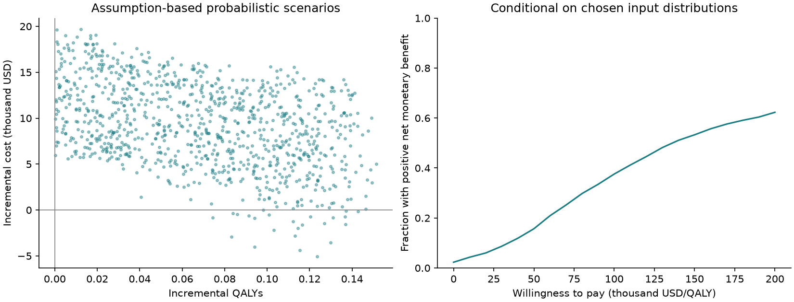

# Dapagliflozin in CKD economic and causal methods project

**Exploratory cost-effectiveness and budget-impact scenarios with a separate synthetic causal-methods study.** Evidence review 11 October 2026. The reference horizon is 10 years; age-100 extrapolation is a sensitivity scenario only.

## Decision and economic output

Dapagliflozin 10 mg daily plus standard care versus standard care without an SGLT2 inhibitor, in a hypothetical albuminuric T2D/CKD cohort with trial-compatible starting stages. Monthly states G1, G2, G3a, G3b, G4, G5, dialysis, transplant, and death; 3% annual discounting and half-cycle occupancy rewards.

Reference incremental cost: $6,024; incremental QALYs: 0.142950; classification: more effective, more costly; ICER: $42,143/QALY; incremental NMB at $100,000/QALY: $8,271. Conditional daily drug-price threshold: $9.7702.

These figures must be read with the scenario register: renal matrices are transferred from a mixed diabetes-status population; stage mortality and age extrapolation are assumptions, utilities use a transferred UK tariff, and spending uses adjusted US proxies. Full healthcare-sector and actual insurer net costs are not estimated.

## Budget output

| Year | Added drug cost | Medical cost change | Net budget | PMPM |
| --- | ---: | ---: | ---: | ---: |
| 1 | $233,314 | -$39,165 | $194,150 | $0.162 |
| 2 | $644,191 | -$174,643 | $469,548 | $0.391 |
| 3 | $1,107,818 | -$414,329 | $693,489 | $0.578 |

Three-year total: $1,357,187. The fixed plan denominator is 100,000 members times 36 months. Initial eligible cohort 1,000, monthly entrants 20 from month two, existing treatment20%, targets current20/20/20% versus expanded30/45/60%, annual plan exits5% and additional stops10%. Fractional people represent expected cohort counts. Current/expanded paths have equal initial and entry populations; survival and exit counts may differ. Starts are limited to never-treated G2–G4 members, with no restart. All BIA members use late renal matrices, including new starts, as a steady-response approximation; early dynamics are included only in CEA. G4 initiation eligibility is an assumed one-third share because within-stage eGFR is unavailable. Entrants start at age65; incumbent age increases.

## Causal methods and results

The separate synthetic target trial compares initiation of dapagliflozin versus sitagliptin with a365-day observable baseline, chronic lab evidence and12-month renal cumulative incidence with competing death. Its artificial drug effect never enters the economic model. SQL reconstructs observed data independently from enrollment, diagnoses, linked laboratories, fills and events; no future enrollment/survival inclusion rule. Toy codes are not deployable clinical phenotypes.

In the primary demonstration, n=4000, true risk difference=-0.033425, IPTW/IPCW estimate=0.001058,95% interval[-0.025422,0.027539]. Treatment propensity is estimated nonparametrically across eight baseline age/severity/HF strata. Censoring probability is estimated within treatment-stratum cells from monthly at-risk opportunities; renal events receive inverse cumulative uncensoring weights. Competing deaths count as zero renal events and are not censored. A treatment-initiation estimand is used; post-index pharmacy patterns do not redefine treatment.

Bootstrap samples with complete censoring in a treatment-stratum cell are also unidentified; no zero censoring survival is divided into an event indicator. The summary records interval failures and coverage among valid intervals. Four simulation settings address measured confounding, measured informative censoring, hidden confounding and structural positivity failure. Each has 200 replicates; full-run samples2,500 with100 nonparametric bootstrap resamples for normal95% intervals, refitting both weights in each resample. Primary demonstration uses300 resamples. Known truth is the conditional finite-baseline-cohort average analytic cumulative incidence under each strategy. Published bias, RMSE, coverage and Monte Carlo errors are in[causal-summary.json](causal-summary.json). No-overlap ATEs are rejected. Finite simulation precision, synthetic mechanisms and limited nuisance-model complexity constrain generalization.

## Validation and limits

Independent discounted cashflow recomputation agrees within1e-6USD; matrix mass conservation, absorbing death, identity scenarios, analytic survival, no-treatment budget, open-population accounting and SQL exclusions are tested. These checks assess computational implementation and accounting. Stage aggregates cannot identify the sustained decline and adjudicated death components of the DAPA-CKD composite. The age-100 scenario depends on the stated extrapolation assumptions.

Public source tables are preserved separately from normalization and assumptions. PSA samples selected subjective distributions; its acceptance curve is conditional on those choices, with no claim to a recovered trial joint distribution. No separate HF benefit, transplant incident cost, or observed adverse-event effect is claimed. Source totals include mixed medical/pharmacy components; an assumed20% pharmacy subtraction and3% annual2023–2026 conversion create background medical proxies. KRT transplant costs represent prevalent averages; dialysis cost is an explicit scenario. Drug MFP is not net payer liability.

See [methods](../METHODS.md), [sources](../SOURCES.md),[parameter register](../parameters/scenario.json),[validation](validation.json) and[run manifest](run-manifest.json).
